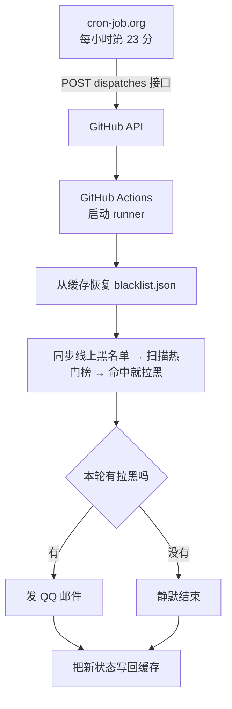

# B站热门关键词拉黑

一个用 **GitHub Actions** 跑的定时任务：每小时扫一遍 B站热门榜，标题 / 推荐理由 / 标签命中关键词的 UP 主直接拉黑。

只有**本轮真的拉黑了人**才发 QQ 邮件；没拉黑、cookie 正常时完全静默。

> 仓库名还叫 `quark-share-monitor`，是历史原因留下的。现在仓库里只有这一个任务。

---

## 它干什么

1. 每轮开始先同步线上黑名单（约 1200 人、20 秒左右），避免对已拉黑的人重复发请求
2. 从热门榜第 1 页开始逐页扫描（最多 50 页），检查每条视频的标题、推荐理由、标签
3. 命中关键词就拉黑对应 UP 主，并记录 `mid` / 昵称 / 命中原因
4. 本轮有拉黑记录才发邮件；否则静默结束
5. cookie 失效时发提醒邮件，同一个失效状态 24 小时内只提醒一次

默认关键词是 **鸣潮**；白名单里的 UP 主永远不会被拉黑（见 [bili_block.py](bili_block.py) 里的 `FILTER_KEYWORD`、`WHITELIST_MIDS`）。

---

## 调度与状态



- **主路径**：cron-job.org 每小时第 23 分 POST `workflow_dispatch`，走实时事件通道，秒级创建 run
- **兜底**：workflow 里保留 `schedule: 23 * * * *`
- 状态文件 `blacklist.json` 和 `cookie_alert.json` 存在 GitHub Actions Cache（`bili-state/`），跨轮保留
- 缓存丢了也能自愈：本地黑名单为空时会自动从线上拉取全部黑名单补齐

GitHub 自带的 `schedule` 实测不太可靠（高负载时会直接丢弃排队超时的任务），所以主路径是外部定时器；`schedule` 只当兜底，重复触发不会重复发邮件（脚本"没拉黑就静默"）。

---

## 目录结构

```
.
├── .github/workflows/
│   └── bili-block.yml       # B站：每小时第 23 分
├── bili_block.py            # 扫描热门榜 + 拉黑 + 发邮件
├── requirements.txt         # requests / aiohttp
└── docs/                    # 本地运维文档（未上传仓库）
    └── cron-job.org-运维手册.md
```

---

## 配置

### Secrets

在 `Settings → Secrets and variables → Actions` 里配置：

| Secret | 用途 |
|---|---|
| `BILI_COOKIE` | B站完整 cookie，必须含 `SESSDATA`、`bili_jct`、`DedeUserID` |
| `SMTP_AUTH_CODE` | QQ 邮箱 SMTP 授权码 |

SMTP 发件人 / 收件人默认都是 `202046940@qq.com`，可用环境变量 `SMTP_SENDER` / `SMTP_RECEIVER` 覆盖。

### 外部定时器

cron-job.org 上只有一个活跃 job：jobId `8467349`，每小时第 23 分 POST 到：

```
https://api.github.com/repos/Furina1027/quark-share-monitor/actions/workflows/bili-block.yml/dispatches
```

请求头带 `Authorization: Bearer <GitHub token>`（fine-grained token，只需 `Actions: Read and write`、只勾本仓库），请求体是 `{"ref":"main"}`。

维护外部定时器请先读本机的 `docs/cron-job.org-运维手册.md`（未上传仓库）——里面写了 API Key 放哪、jobId、改触发时间 / 轮换 token 的完整代码和故障排查表。

---

## 本地运行

```bash
pip install -r requirements.txt

# 必须：B站完整 cookie（含 SESSDATA / bili_jct / DedeUserID）
export BILI_COOKIE="..."
# 可选：不设就不发邮件，只打印结果
export SMTP_AUTH_CODE="..."

python bili_block.py          # 默认关键词：鸣潮
python bili_block.py 关键词    # 临时换关键词
python bili_block.py -s       # 强制重新同步线上黑名单
```

可选环境变量：

| 变量 | 作用 |
|---|---|
| `BILI_STATE_DIR` | 状态目录，默认脚本所在目录 |
| `BILI_SYNC_EVERY_RUN` | 默认 `1`（每轮都同步线上黑名单）；设 `0` 则只在首轮或 `-s` 时同步 |
| `SMTP_SENDER` / `SMTP_RECEIVER` | 邮件发件人 / 收件人 |

### 更新 cookie

cookie 失效时脚本会发提醒邮件（24 小时冷却）。更新仓库 Secret：

```bash
gh secret set BILI_COOKIE -R Furina1027/quark-share-monitor
```

本机另有 `update_bili_cookie.py` / `update_bili_cookie.bat`（未上传仓库），可以读剪贴板、在线验证 cookie 并写入 Secret。

---

## 已知注意事项

- **cookie 会过期**。失效时任务拉不了人，但会发提醒邮件，不会静默失败。
- **每轮都会同步一次线上黑名单**（约 1200 人、20 秒），保证不会对已拉黑的人重复发请求。
- **公开仓库 60 天没有任何提交，GitHub 会自动禁用 `schedule`**；外部 cron-job.org 的 `workflow_dispatch` 不受这条规则影响，主路径仍然可用。
